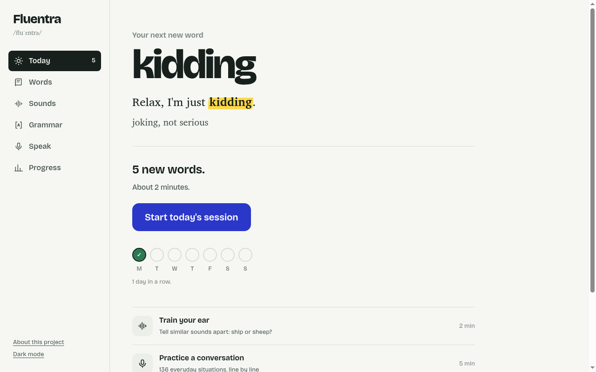
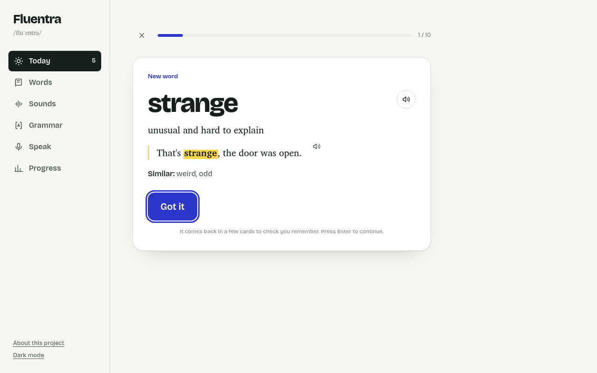
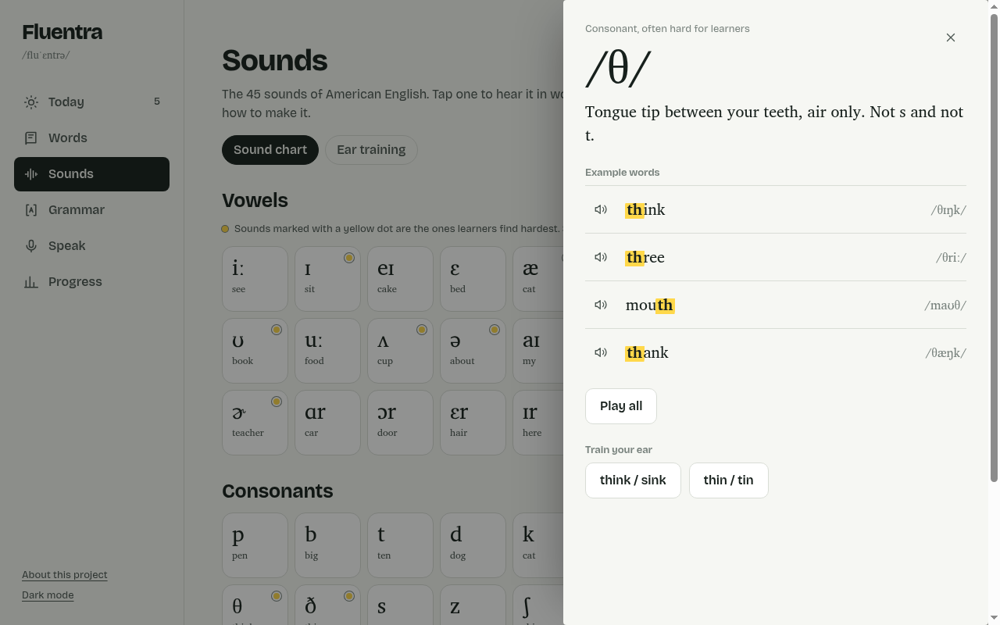
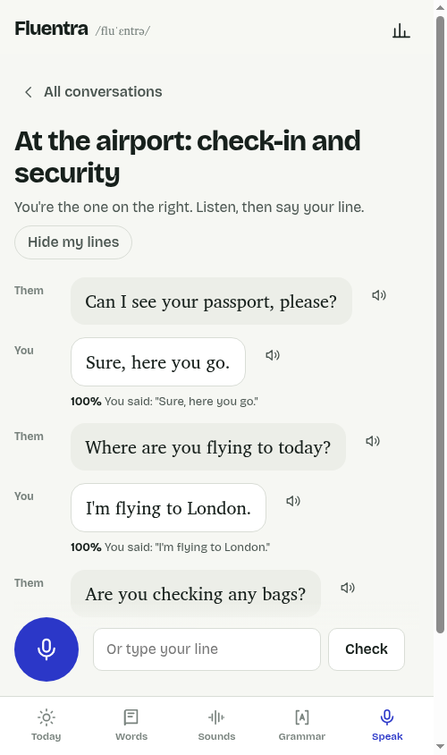

# Fluentra

**Learn American English the way it sticks.** Fluentra is a free web app for intermediate learners who want to become fluent: 3,600 words learned inside real sentences with spaced repetition, the 45 sounds of American English with ear training, 42 grammar points with quizzes, and 136 everyday conversations to practice speaking out loud.

No account, no server, no tracking. It runs entirely in the browser and works offline.



## Features

| | |
|---|---|
| **Daily sessions** | Reviews that are due plus new words in course order, mixed so each new word comes back as a recall test a few cards after you first see it. |
| **Recall first** | Reviews show the meaning and an example sentence with a gap. You type the word (typos are caught as "almost"), then rate how well you knew it. |
| **Spaced repetition** | An SM-2 style scheduler with four answers (Again, Hard, Good, Easy). Each button shows when the word will come back. |
| **Real video clips** | Any word or phrase can be heard in real YouTube clips via the YouGlish widget, loaded only when you ask. |
| **Sounds** | An interactive IPA chart: each sound with how to make it and example words with the matching letters highlighted. |
| **Ear training** | Minimal pairs (ship / sheep, think / sink) in rounds of 12, weighted toward the pairs you get wrong. |
| **Grammar** | 42 points from basics to advanced: why it matters, the pattern, how Americans actually say it, common mistakes, and a quiz. |
| **Speaking** | Conversations line by line. Speech recognition scores how close your line was, and "Hide my lines" turns it into a memory exercise. |
| **Progress** | Words learned and studied, a streak, recall accuracy, an activity grid, and progress by level. Export, import or erase your data. |







## How it's built

- **No framework, no build step, no dependencies.** Plain ES modules, HTML and CSS. Pages are loaded on demand by a small hash router.
- **Pure, tested core.** Scheduling (`js/core/srs.js`), session planning (`session.js`), answer checking (`text.js`), ear-training rounds (`ear.js`) and progress statistics (`progress.js`) are pure functions with no DOM access, covered by Node's built-in test runner.
- **Content tests.** `tests/data.test.mjs` checks every data file: no duplicates, valid quiz answers, sound examples pointing at real letters, English-only text, and an offline cache list that matches the files on disk.
- **Offline and installable.** A service worker caches the app and its data (network first, cache as fallback), and a web manifest makes it installable on phones.
- **On-device speech.** Listening and speaking use the browser's Web Speech API, so voice data never touches a Fluentra server.
- **Accessible.** Keyboard shortcuts in sessions (Enter, 1 to 4, Space), visible focus, labeled controls, reduced-motion support, and light and dark themes.

```
index.html          app shell and navigation
css/app.css         design tokens, light and dark themes, all styles
js/app.js           router and navigation
js/core/            pure learning logic (tested)
js/views/           one module per page
js/speech.js        text-to-speech and speech recognition
js/store.js         local storage, export and import
data/               course content as JSON
tests/              node:test suites for the logic and the content
```

## Run it locally

Any static file server works. With Python:

```sh
python3 -m http.server 8080
```

Then open <http://localhost:8080>. Speech recognition needs Chrome, Edge or Safari, and a secure context (localhost counts).

## Tests

Requires Node.js 20 or newer:

```sh
npm test
```

The same tests run on every push with GitHub Actions.

## Deploy

Fluentra is static, so it can be hosted for free on GitHub Pages, Netlify or Cloudflare Pages. For GitHub Pages: Settings → Pages → Deploy from branch → `main`, folder `/ (root)`.

## Credits

- Real-world video clips: [YouGlish](https://youglish.com) embed widget.
- Typefaces: [Bricolage Grotesque](https://fonts.google.com/specimen/Bricolage+Grotesque) and [Charis SIL](https://software.sil.org/charis/) (designed for phonetic symbols), via Google Fonts.

Designed and built by Ali Alassaf, with Claude Code as an AI pair programmer.

## License

Code: [MIT](LICENSE). Course content in `/data`: © Ali Alassaf, free to use for personal learning.
